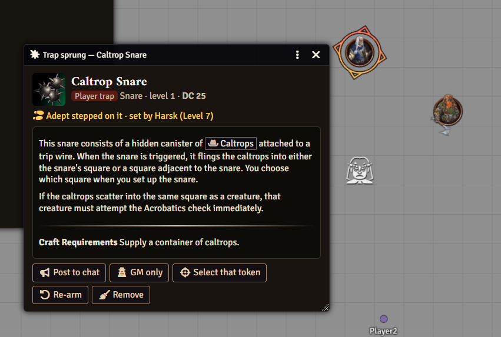
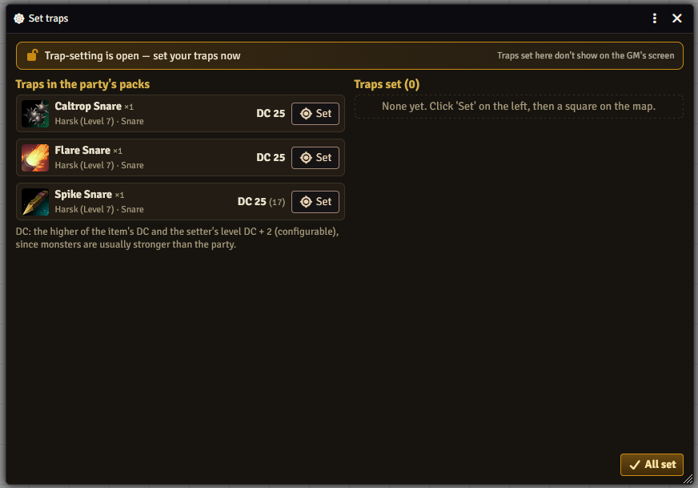
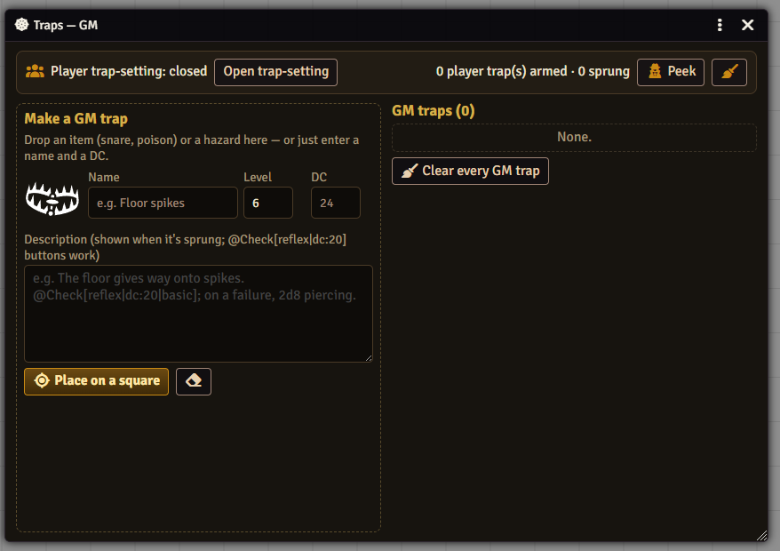

# Rutz's Traps

[Patreon](https://www.patreon.com/Rutz179) · [Discord](https://discord.gg/pnVW5QmXKx) · [Wiki](https://github.com/Rutz179/rutz-pf2e-traps/wiki) · [한국어](README.ko.md)

Players set traps the GM can't see; the GM finds out when something steps on one. For Foundry VTT — PF2e and D&D 5e rules built in, any other system with generic DCs.



## Features
- **Hidden player traps** — when the GM opens trap-setting time, players place the snares, traps, poisons and caltrops in the party's packs on the map. Only the players see the markers.
- **Sprung** — a creature that walks onto one stops on the square, and the GM gets the trap like a used item: its description with the DC already applied, who stepped on it and who set it. Post it to chat, keep it secret, re-arm it or clear it away.
- **GM traps** — drop an item or a hazard on the GM's window (or type a name and a DC) and click a square.
- **A secret peek** — the GM can look at the players' traps for a few seconds, without anyone being told (or with a chat line — a setting).
- **DCs that keep up** — a shop snare's own DC is too low for the monsters it's set for, so by default the trap takes the setter's level DC + 2 when that's higher: PF2e GM Core DCs, D&D 5e 8 + proficiency + 3, or 10 + half the level elsewhere.
- Works on its own — no other module needed.

 

## Install
Foundry → *Add-on Modules* → *Install Module* → Manifest URL:
```
https://github.com/Rutz179/rutz-pf2e-traps/releases/latest/download/module.json
```
Foundry VTT v13–v14 · PF2e · D&D 5e · any system · English / 한국어 (follows Foundry's language)

## Quick start
1. GM: **Traps (GM)** in the token controls → **Open trap-setting**.
2. Players: the **Set traps** window opens — **Set** next to a trap, then click a square. **All set** tells the GM how many (not where).
3. GM: **Close trap-setting** and play. When a creature walks onto a trap, its window pops up on the GM's screen.

Full guide: **[Wiki](https://github.com/Rutz179/rutz-pf2e-traps/wiki)** · Macro: `game.rutzTraps.open()`

Questions and bug reports: [Issues](https://github.com/Rutz179/rutz-pf2e-traps/issues) or [Discord](https://discord.gg/pnVW5QmXKx).
